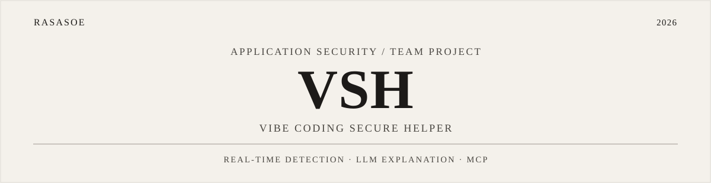
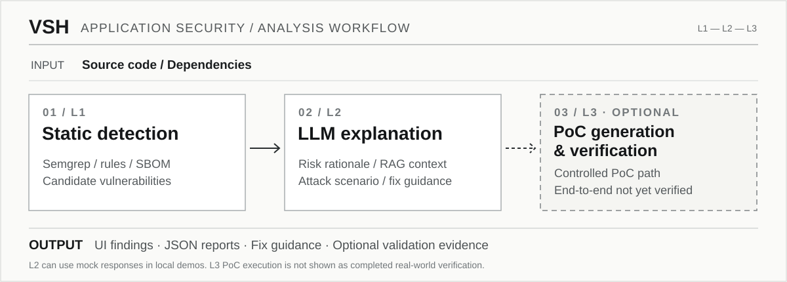
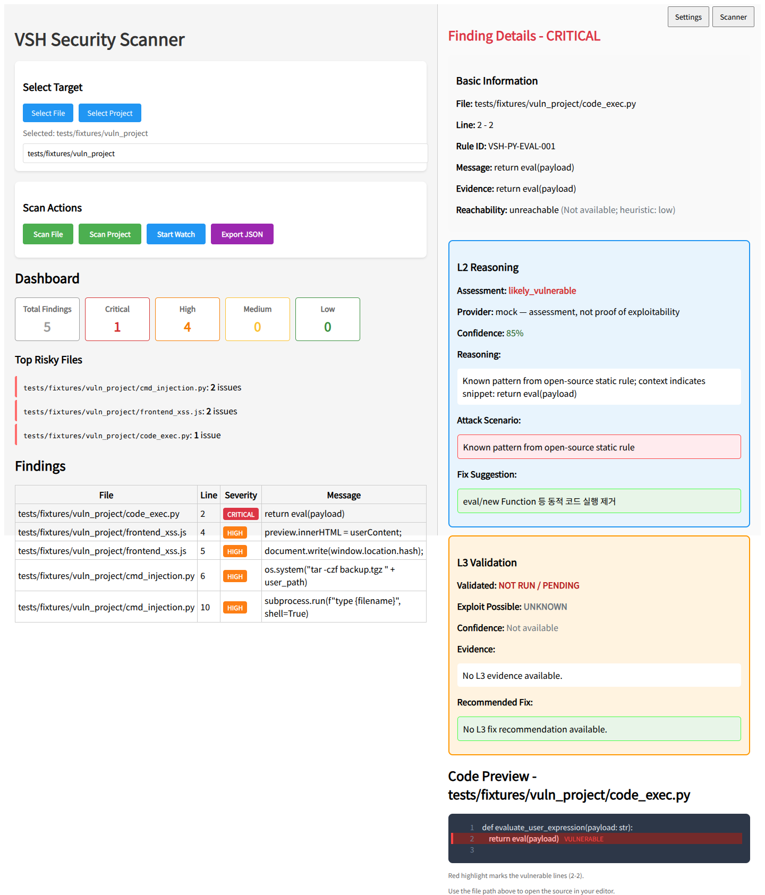
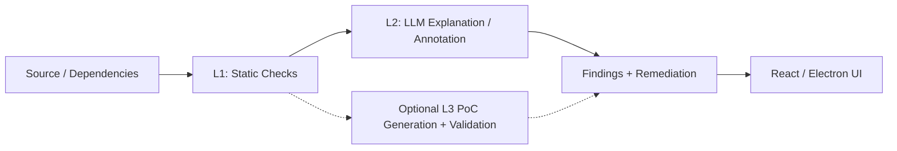

# VSH — Application Security Analysis

  🌐 README language · <a href="README.md">🇰🇷 한국어</a> · <strong>🇺🇸 English</strong>

> **Attribution:** VSH is a fork of [vmfmgl0607/VSH](https://github.com/vmfmgl0607/VSH), extended with Semgrep/tool configuration integration, a versioned Finding export format, documentation, and validation. The upstream project is **not** claimed as entirely original work.

## Why we built VSH

**VSH (Vibe Coding Secure Helper)** began with a practical question: as AI-assisted vibe coding accelerates development, **could security issues be surfaced and explained as the developer writes and saves code, with actionable fixes suggested immediately?**

The project is an **MCP-enabled application security assistant**. File-change detection, L1 static scanning, L2 LLM explanations and suggested fixes, and optional L3 PoC-oriented validation form its analysis pipeline. MCP is the interface to AI coding tools; the desktop app in this fork is a separate presentation layer.

**Team submission:** February 2026 · **Individual fork enhancements/retesting:** September 2026 (original project start date not confirmed).

**Two deliverables:** The [team's final MVP-final branch](https://github.com/vmfmgl0607/VSH/tree/MVP-final) contains a FastMCP server and file-watching demo. This fork focuses on further Semgrep/tool integration, React/Electron UI, normalized Finding JSON exports and tests.

**Limitations:** The final team watcher is configured for the `vuln_sample.py` demo file, not arbitrary projects. Its MCP `apply_fix` tool returns proposed code and marks the issue accepted; it does not automatically rewrite the source file.

- **Evidence:** 81 unit tests passed, 81 passed again in reverse order, and the React production build and local fixture UI were validated (September 16, 2026).
- **Not verified:** Real LLM reasoning quality, end-to-end L3 exploitability validation, or detection accuracy in production. Mock responses are not presented as real security findings.

## Three-layer AppSec workflow

VSH targets a developer-facing **L1 static detection → L2 LLM explanation → optional L3 proof-of-concept (PoC) generation and verification** workflow.

<picture>
  <source media="(max-width: 600px)" srcset="docs/assets/vsh-workflow-mobile.svg">
  
</picture>

| Layer | Responsibility | Verified boundary |
| --- | --- | --- |
| **L1 — Detection** | Static analysis of code and dependencies through Semgrep and auxiliary rules | Real Semgrep execution integration and local fixture tests |
| **L2 — LLM explanation** | Explain risk, attack scenarios, and remediation using LLM/RAG context | Provider architecture is present; public demo explanations use mocks |
| **L3 — PoC generation and verification** | Optional PoC templates/generation path and controlled validation, supplemented by SonarQube/SBOM signals | End-to-end real PoC generation and execution remain unverified |

LLM explanations alone are not proof of exploitability, and unverified findings remain marked as candidates.

## Demo

*Actual local React UI and FastAPI fixture scan. Input: `tests/fixtures/vuln_project`; L2 explanation uses a **mock** provider; L3 is disabled. This does not establish actual LLM, SonarQube, PoC, or Electron packaged-app performance.* [Validation evidence](docs/portfolio-verification.md)

## Project at a glance

| Layer | Role | Scope |
| --- | --- | --- |
| L1 — Static findings | Source/dependency checks, including Semgrep integration | Findings are candidates for review |
| L2 — LLM explanations | Model/RAG-based risk rationale, attack scenarios, and remediation | Public fixture demo uses mock reasoning; real LLM quality is unverified |
| L3 — PoC generation & verification | Optional PoC templates and controlled validation, with SonarQube/SBOM supporting evidence | Real end-to-end PoC execution is not yet verified |
| Desktop and API | React/Electron front end, FastAPI runtime | Local prototyping |
| Finding v1.0 | Versioned output for downstream tools | Implemented; integrated dashboard is not yet available |

## My contribution and verifiable changes

- **Semgrep executable integration and tooling/settings UX:** [commit](https://github.com/rasasoe/VSH/commit/ec15330c937432141ac62ae039c4b8f003f34546)
- **Windows Semgrep/Syft wrappers and local SonarQube configuration:** [wrapper](https://github.com/rasasoe/VSH/commit/0ec3f068e3402d1e4350990e5a4b51f03dd416d9) · [settings](https://github.com/rasasoe/VSH/commit/1a7e755e36cab8dafd6a0e40d1a392c0a74719be)
- **Finding v1.0 export, CLI output directory, contract tests and CI:** [PR #1](https://github.com/rasasoe/VSH/pull/1/files)
- **Architecture and evidence boundary documentation:** [README revision](https://github.com/rasasoe/VSH/commit/0f2f73c5ca6242f29926bf977edfa2d092050ab7)

## Recorded checks and limitations

At the **September 16, 2026** checkpoint: **81 unit tests passed**, the reverse-order test run passed **81**, and the React production build passed. The local fixture demonstrated findings and their not-verified status.

These checks **do not** prove exploitability, detection accuracy, live LLM quality, or production security. The three security tools (VSH, ASM, DotasPlus) can export normalized findings, but a shared operational dashboard is future work.

## Documentation and use

- [Full Korean documentation / 한국어 상세 문서](README.md) — installation, CLI, API, environment configuration and troubleshooting
- [Portfolio verification log](docs/portfolio-verification.md)
- [Upstream VSH](https://github.com/vmfmgl0607/VSH)

For reproducibility, use the setup and scope guidance in the Korean README and keep test targets authorized.

---

*VSH · Application Security Prototype · Upstream fork with independently documented extensions*
