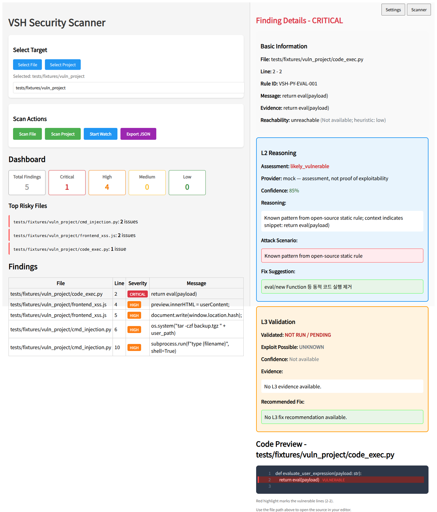
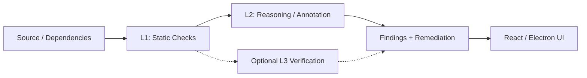

# VSH — Application Security Analysis

  🌐 README language · <a href="README.md">🇰🇷 한국어</a> · <strong>🇺🇸 English</strong>

**Source code and dependency findings, explained and reviewed through a desktop-oriented AppSec workflow.**

> **Attribution:** VSH is a fork of [vmfmgl0607/VSH](https://github.com/vmfmgl0607/VSH), extended with Semgrep/tool configuration integration, a versioned Finding export format, documentation, and validation. The upstream project is **not** claimed as entirely original work.

## Demo

*Actual local React UI and FastAPI fixture scan. Input: `tests/fixtures/vuln_project`; L2 explanation uses a **mock** provider; L3 is disabled. This does not establish actual LLM, SonarQube, PoC, or Electron packaged-app performance.* [Validation evidence](docs/portfolio-verification.md)

## Project at a glance

| Layer | Role | Scope |
| --- | --- | --- |
| L1 — Static findings | Source/dependency checks, including Semgrep integration | Findings are candidates for review |
| L2 — Reasoning | Explanations and remediation-oriented context | Mock/LLM modes; not all demo output uses a live LLM |
| L3 — Extended verification | Optional SonarQube, SBOM and deeper validation paths | Not part of the fixture demo |
| Desktop and API | React/Electron front end, FastAPI runtime | Local prototyping |
| Finding v1.0 | Versioned output for downstream tools | Implemented; integrated dashboard is not yet available |

## My contribution and verifiable changes

- **Semgrep executable integration and tooling/settings UX:** [commit](https://github.com/rasasoe/VSH/commit/ec15330c937432141ac62ae039c4b8f003f34546)
- **Windows Semgrep/Syft wrappers and local SonarQube configuration:** [wrapper](https://github.com/rasasoe/VSH/commit/0ec3f068e3402d1e4350990e5a4b51f03dd416d9) · [settings](https://github.com/rasasoe/VSH/commit/1a7e755e36cab8dafd6a0e40d1a392c0a74719be)
- **Finding v1.0 export, CLI output directory, contract tests and CI:** [PR #1](https://github.com/rasasoe/VSH/pull/1/files)
- **Architecture and evidence boundary documentation:** [README revision](https://github.com/rasasoe/VSH/commit/0f2f73c5ca6242f29926bf977edfa2d092050ab7)

## Recorded checks and limitations

At the **September 16, 2026** checkpoint: **81 unit tests passed**, the reverse-order test run passed **81**, and the React production build passed. The local fixture demonstrated findings and their not-verified status.

These checks **do not** prove exploitability, detection accuracy, live LLM quality, or production security. The three security tools (VSH, ASM, DotasPlus) can export normalized findings, but a shared operational dashboard is future work.

## Documentation and use

- [Full Korean documentation / 한국어 상세 문서](README.md) — installation, CLI, API, environment configuration and troubleshooting
- [Portfolio verification log](docs/portfolio-verification.md)
- [Upstream VSH](https://github.com/vmfmgl0607/VSH)

For reproducibility, use the setup and scope guidance in the Korean README and keep test targets authorized.

---

*VSH · Application Security Prototype · Upstream fork with independently documented extensions*
